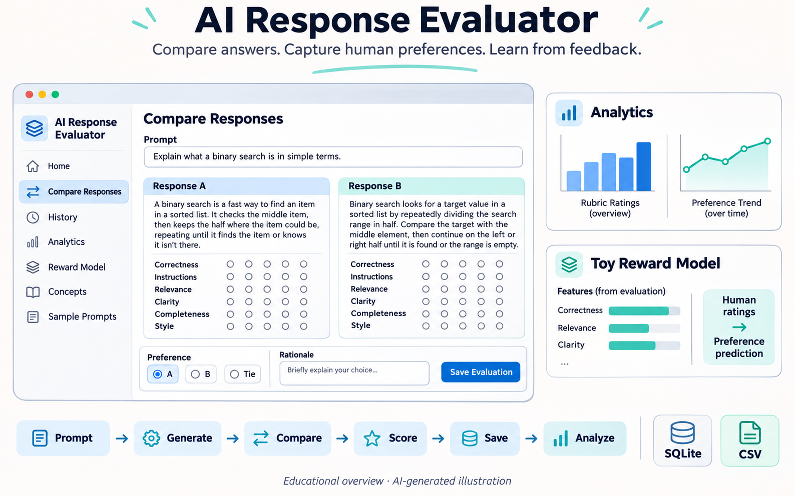

# AI Response Evaluator



*AI-generated application overview. This is an illustration, not a screenshot or measured evaluation results.*

A beginner-friendly Python application for comparing AI answers and collecting human preference data. Generate two responses to the same prompt, score them with a six-category rubric, choose a preferred answer, and explore the results in a local dashboard.

This is an educational portfolio project. It demonstrates the feedback and evaluation workflow behind model improvement; it does not fine-tune a language model or run large-scale RLHF.

## Why this project matters

A fluent answer can still ignore a deadline, use the wrong reading level, or contain a factual error. Comparing answers against explicit criteria makes these differences easier to see. Saving both the preference and its rationale creates a dataset that can be inspected instead of relying on an impression that one answer “sounds better.”

## Key concepts demonstrated

- **Human feedback and preference data:** a person's choice between two answers, supported by scores and an explanation.
- **Supervised fine-tuning (SFT):** learning from examples of desired answers. The app explains SFT but does not perform it; preference judgments are not automatically verified SFT targets.
- **RLHF and reward modeling:** using human judgments to help define what a model should optimize. A small classifier illustrates part of this idea.
- **Instruction following and evaluation:** checking accuracy, explicit constraints, relevance, clarity, completeness, and style separately.
- **Response ranking and iterative improvement:** comparing candidates, finding failures, revising instructions, and evaluating again.
- **Reward misalignment:** a scoring rule can favor a polite answer that fails the actual task.

## Features

The sidebar contains seven pages, registered explicitly with Streamlit's `st.navigation`:

| Page | What you can do |
| --- | --- |
| Home | Learn the workflow and the main concepts. |
| Compare Responses | Enter a prompt and optional constraints, generate independent answers, score each from 1–5, choose A/B/Tie, and save a rationale. |
| Evaluation History | Filter by preference, inclusive UTC date range, or literal search text; inspect complete records; export the filtered rows. |
| Analytics Dashboard | See evaluation totals, preference percentages, overall averages, rubric averages, preference counts, and score trends. |
| Reward Model Demo | Fit a toy logistic regression classifier, inspect coefficients, and compare predictions with human choices. |
| Concepts | Read beginner explanations and interact with a politeness-versus-deadline reward example. |
| Sample Prompts | Click one of ten examples to populate the comparison inputs. |

The comparison page preserves an unfinished evaluation while navigating between pages in the same browser session. It prevents saving old answers under a newly edited prompt, requires a preference and rationale, and prevents duplicate saves of the same response pair. These session drafts are not durable storage: save an evaluation before ending the session.

## Architecture

```text
Browser / Streamlit pages
        |
        +-- prompt + constraints --> OpenAI Responses API --> Answer A and Answer B
        |
        +-- human scores + preference + rationale
                    |
              validation helpers
                    |
                 SQLite
                    |
        +-----------+-------------+
        |           |             |
      History    Analytics    Reward-model demo
        |        Matplotlib   scikit-learn
      CSV export
```

Streamlit supplies both the browser interface and the Python application server. There is no separate JavaScript frontend or REST backend to configure. Modules under `src/` keep API calls, validation, storage, analysis, and model fitting separate from the page code.

```text
AI-Response-Evaluator/
├── app.py
├── pages/
│   ├── 1_Compare_Responses.py
│   ├── 2_Evaluation_History.py
│   ├── 3_Analytics.py
│   ├── 4_Reward_Model.py
│   ├── 5_Concepts.py
│   └── 6_Sample_Prompts.py
├── src/
│   ├── __init__.py
│   ├── config.py
│   ├── openai_client.py
│   ├── evaluation.py
│   ├── database.py
│   ├── analytics.py
│   ├── reward_model.py
│   ├── sample_prompts.py
│   └── ui.py
├── docs/
│   ├── images/application-overview.png
│   └── image-generation.md
├── tests/
├── data/
│   └── .gitkeep
├── .streamlit/
│   └── config.toml
├── .env.example
├── .gitignore
├── pytest.ini
├── requirements.txt
└── README.md
```

The database and your `.env` file are created locally and are not committed.

## Technology stack

| Technology | Purpose |
| --- | --- |
| Python | Application and data-processing code |
| Streamlit | Multipage interface and local application server |
| Official OpenAI Python SDK | Generate text through the Responses API |
| Pandas | Dataframes, filtering, summaries, and CSV export |
| SQLite | Durable local storage; included with Python |
| Matplotlib | Preference, rubric, and trend charts |
| scikit-learn | Logistic regression and a reproducible train/test split |
| NumPy | Validate numerical features for the toy classifier |
| python-dotenv | Read project configuration from `.env` |
| pytest | Automated tests without live OpenAI requests |

The integration follows the [official OpenAI Python SDK documentation](https://developers.openai.com/api/reference/python). Its configurable default is [`gpt-4.1-mini`](https://developers.openai.com/api/docs/models/gpt-4.1-mini).

## Installation

Use Python **3.11 or newer**; the project was checked with Python **3.12.6**. Open a terminal inside the `AI-Response-Evaluator` folder.

Create a virtual environment:

```sh
python -m venv venv
```

On macOS/Linux, if `python` is unavailable, use `python3 -m venv venv` for this step.

Activate it on macOS/Linux:

```sh
source venv/bin/activate
```

Activate it in Windows Command Prompt:

```bat
venv\Scripts\activate
```

Or activate it in Windows PowerShell:

```powershell
.\venv\Scripts\Activate.ps1
```

Install the dependencies in the activated environment:

```sh
pip install -r requirements.txt
```

## Environment setup

Copy the example configuration once, then edit the new `.env` file.

macOS/Linux:

```sh
cp .env.example .env
```

Windows PowerShell:

```powershell
Copy-Item .env.example .env
```

Replace the placeholder with your own OpenAI API key:

```dotenv
OPENAI_API_KEY=your_api_key_here
OPENAI_MODEL=gpt-4.1-mini
OPENAI_USE_TEMPERATURE=true
OPENAI_TEMPERATURE_A=0.4
OPENAI_TEMPERATURE_B=0.9
OPENAI_MAX_OUTPUT_TOKENS=1024
EVALUATOR_DB_PATH=data/evaluations.db
```

Create or manage your key in the [OpenAI API dashboard](https://platform.openai.com/api-keys). Keep the actual key in `.env`, which is excluded by `.gitignore`; do not put it in source code, screenshots, or a public repository.

| Setting | Behavior |
| --- | --- |
| `OPENAI_API_KEY` | Required only for generating responses. The example placeholder is treated as a missing key. |
| `OPENAI_MODEL` | Model used for both candidates. Your API account must have access to it. |
| `OPENAI_USE_TEMPERATURE` | Set to `false` for models that do not support the temperature parameter. |
| `OPENAI_TEMPERATURE_A` / `OPENAI_TEMPERATURE_B` | Numbers from 0 to 2; also adjustable on the comparison page. Higher randomness does not mean better quality. |
| `OPENAI_MAX_OUTPUT_TOKENS` | Output budget per API request; the app accepts integers from 64 to 16384. The chosen model may impose its own restrictions. |
| `EVALUATOR_DB_PATH` | SQLite file location. Relative paths resolve from the project folder; absolute paths are also supported. |

Settings are reread from the project `.env` file on rerun. Existing process environment variables take priority, and the app does not write `.env` values into the process environment. A malformed setting produces a helpful message.

Without an API key, the learning pages still work and existing saved data can be inspected. Generation is disabled with setup guidance; the app does not substitute fabricated AI answers.

## How to run

From the project folder, with the virtual environment activated:

```sh
streamlit run app.py
```

Open the local URL printed by Streamlit, normally `http://localhost:8501`. Use the sidebar to move between pages. Stop the server with `Ctrl+C` in the terminal.

The database directory and `evaluations` table are initialized automatically when storage is first used. A new installation starts with an empty dataset; no synthetic evaluations are preloaded. History, analytics, and the reward demo explain what to collect next when data is missing.

Run the automated checks with:

```sh
python -m pytest
```

Tests use temporary databases and mocked API responses. They cover validation, storage, filtering and CSV behavior, configuration, generation failures, analytics, and the toy reward model without requiring an API key or sending live OpenAI requests.

## Example workflow

1. Open **Sample Prompts** and select the gravity explanation for a 7-year-old.
2. Review the populated prompt and constraints on **Compare Responses**.
3. Click **Generate Responses**. This sends the prompt and constraints to OpenAI and can incur API charges.
4. Read both answers. Score every rubric category; sliders start at 3 as a neutral starting value, not an automatic evaluation.
5. Choose **Response A**, **Response B**, or **Tie**. Explain the decision, such as “A obeys the sentence limit; B introduces jargon.”
6. Click **Save Evaluation** and check the success confirmation.
7. Inspect the saved record in **Evaluation History**, filter it, and use **Download as CSV**.
8. Collect more judgments and review **Analytics Dashboard**. When enough eligible examples exist, open **Reward Model Demo**.
9. Revise a prompt or constraint based on observed failures, generate again, and compare the new results. The app does not automatically improve the underlying language model.

Each candidate is generated in a separate API request. A uses a direct writing approach; B uses alternative wording or organization when the task allows it. Both receive the same task and constraints, and neither receives the other's answer. If the answers are identical, B gets one independent retry. The SDK can also retry a failed HTTP request once, so total HTTP attempts can exceed the number of candidate-generation requests. Persistent duplicates, incomplete responses, refusals, and API errors produce a helpful message rather than a fabricated or partial pair.

## Database structure and exports

The default file is `data/evaluations.db`. Its single `evaluations` table stores the following **22 fields**:

| Fields | SQLite type and meaning |
| --- | --- |
| `evaluation_id` | `TEXT` primary key; UUID identifying one evaluation |
| `timestamp` | `TEXT`; ISO 8601 timestamp in UTC |
| `prompt`, `constraints` | `TEXT`; the task and optional requirements used for the pair |
| `response_a`, `response_b` | `TEXT`; the two generated answers |
| `preferred_response` | `TEXT`; one of `A`, `B`, or `Tie` |
| `rationale` | `TEXT`; required human explanation |
| `A_correctness`, `A_instruction_following`, `A_relevance`, `A_clarity`, `A_completeness`, `A_style` | `INTEGER`; six ratings from 1 through 5 for A |
| `A_average_score` | `REAL`; unrounded arithmetic mean of A's six ratings |
| `B_correctness`, `B_instruction_following`, `B_relevance`, `B_clarity`, `B_completeness`, `B_style` | `INTEGER`; six ratings from 1 through 5 for B |
| `B_average_score` | `REAL`; unrounded arithmetic mean of B's six ratings |

Application validation checks required text, preferences, integer ratings, IDs, timestamps, and matching averages. SQLite constraints reinforce the stored types and allowed values. Parameterized writes store user text as data. Saving an existing evaluation ID again does not create a duplicate or overwrite the earlier judgment.

The history date filter is inclusive and uses **UTC**, as do the timestamps and trend chart. Search is case-insensitive literal text across prompts, constraints, both answers, and rationales.

**Download as CSV** exports every column for the currently filtered rows, without a dataframe index. Quotes, commas, and line breaks use standard CSV quoting. Text that could be interpreted as a spreadsheet formula receives a leading apostrophe in the export; the original database values remain unchanged. Account for that prefix if you later use the CSV as a training-data source.

Saved evaluations are local files. Back up the SQLite file if you want to preserve your dataset; changing `EVALUATOR_DB_PATH` selects a different database rather than moving existing records.

## Reward model explanation

The demo asks a narrow question: **Can human rubric ratings predict the person's A/B preference?**

For each category it constructs a difference:

```text
feature = Response A's score − Response B's score
label   = 1 when A is preferred, 0 when B is preferred
```

It excludes ties, then requires at least **10 non-tied evaluations**, with at least **4 preferring A and 4 preferring B**. These are classroom-sized minimums, not a recommendation for a reliable production dataset. Keep judgments honest instead of choosing a response to satisfy the threshold.

The implementation makes a reproducible, stratified **75% training / 25% held-out** split. Whole-row rounding means the exact counts depend on dataset size. Logistic regression is fitted only on the training subset, and accuracy is measured on the held-out subset. The displayed model is not refitted on held-out examples. A majority-class baseline helps put the accuracy in context.

The page shows training and held-out counts, accuracy, baseline accuracy, feature coefficients, and predicted probabilities for a selected record. It labels that record as training, held-out, or excluded/unseen. A positive coefficient means a higher A-minus-B rating in that category tends to favor A in this dataset; it does not establish objective importance or causation. The model cannot predict a tie.

This is a **toy preference classifier based on human scores**, not a text reward model. It needs rubric ratings before making a prediction and never changes the response-generating model's weights.

The **Concepts** page also provides an interactive reward-misalignment example. Increasing the weight on politeness can favor “Whenever you have a chance…” even though the request requires preserving today's deadline. Changing the scoring rule reveals why a reward must reflect the actual objective.

## Limitations

- No language-model fine-tuning, PPO, reinforcement-learning training loop, or language-model weight updates occur.
- Small, subjective datasets produce unstable accuracy. Repeated or similar prompts can cross the random split and make results look better than performance on genuinely new tasks.
- Rubric scores are supplied by humans, so the classifier does not independently assess factual correctness or read response text. Its probabilities are uncalibrated estimates.
- A and B come from the same configured model with different writing approaches and optional temperatures. Preference percentages are not a comparison between two model families, and visible A/B positions may introduce bias.
- Scores over time may reflect changing prompts or evaluators. A rising trend does not prove the AI improved.
- Saved records follow the specified schema; model/version and generation settings are not stored as additional columns. The current pair's model is shown during the session.
- The app has no authentication, per-user isolation, or production deployment configuration. It is intended for local use. Prompts and constraints are sent to OpenAI only when generation is requested; saved evaluations remain in the configured SQLite file.
- API availability, model access, rate limits, and usage charges depend on the OpenAI account. No live API request is required by the test suite.

## Future improvements

- Record model versions, generation settings, and prompt versions for reproducible experiments.
- Add blinded/randomized candidate ordering and multiple evaluators with agreement measures.
- Evaluate on held-out prompt groups and larger, more representative datasets.
- Add reviewed exports for preference-training or SFT workflows without assuming every chosen answer is correct.
- Explore text-based reward models and compare them with the simple rubric baseline.
- Add authentication, storage migrations, and deployment safeguards if the app becomes a shared service.


## Full application process

1. `app.py` registers all seven pages; sample choices populate session inputs.
2. `src/config.py` reads `.env` and environment settings without exposing the key.
3. `src/openai_client.py` makes independent Responses API calls. It accepts only complete, distinct text outputs and handles missing credentials and API failures.
4. The comparison page keeps the original prompt with its responses. You supply six scores per answer, a preference, and a rationale.
5. `src/evaluation.py` validates the feedback and calculates averages. `src/database.py` saves it with an idempotent UUID in SQLite.
6. History retrieves fresh records, applies filters, shows full details, and exports CSV. `src/analytics.py` calculates chart data.
7. `src/reward_model.py` excludes ties, constructs A-minus-B rating features, splits data, trains logistic regression, and reports held-out performance.
8. Review weaknesses, revise instructions, and collect new evaluations. The response-generating model is never trained by this application.

## Troubleshooting

| Problem | What to check |
| --- | --- |
| Generate button is disabled | Add a real `OPENAI_API_KEY` to `.env`; an exported environment variable takes priority over the file. |
| Model or sampling request rejected | Verify model access and set `OPENAI_USE_TEMPERATURE=false` if that model does not support temperature. |
| Response is incomplete | Shorten the request or raise `OPENAI_MAX_OUTPUT_TOKENS` within the chosen model's supported limits. |
| Database cannot open | Make sure `EVALUATOR_DB_PATH` names a file in a writable folder. |
| Reward demo cannot train | Collect at least 10 non-tied evaluations, including at least four A and four B preferences. Do not manufacture preferences to meet the threshold. |
| An edited prompt cannot be saved | Generate a new response pair, or restore the prompt and constraints used for the current pair. |

## Development and Git publishing

From the project folder with the virtual environment active:

```sh
python -m pytest
python -m compileall -q app.py pages src tests
git diff --check
git status --short
```

Review changes, then publish the application and documentation:

```sh
git add app.py pages src tests data/.gitkeep .streamlit/config.toml .env.example .gitignore pytest.ini requirements.txt README.md docs
git diff --cached --stat
git commit -m "Build AI Response Evaluator with documentation and overview image"
git push origin main
```

The configured repository is [sreytouch/AI-Response-Evaluator](https://github.com/sreytouch/AI-Response-Evaluator). Publishing code does not deploy a running Streamlit service. `.env`, databases, virtual environments, and local caches remain excluded. The supplied `prmpt.txt` brief is a local reference and is not needed to run the application.

The overview graphic was created with built-in image generation. Its prompt is recorded in [image-generation.md](docs/image-generation.md).
